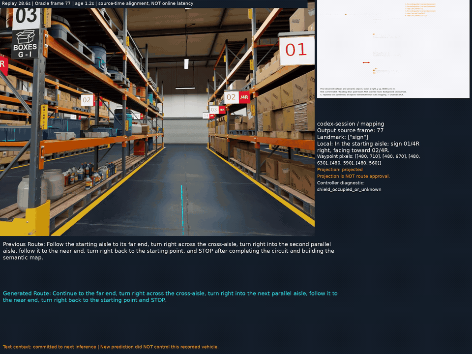
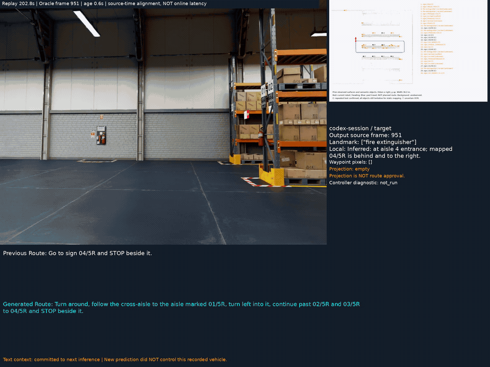
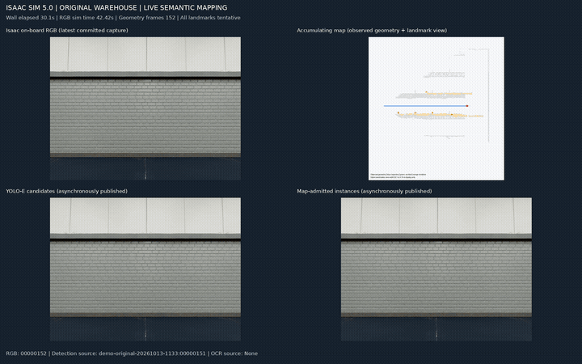
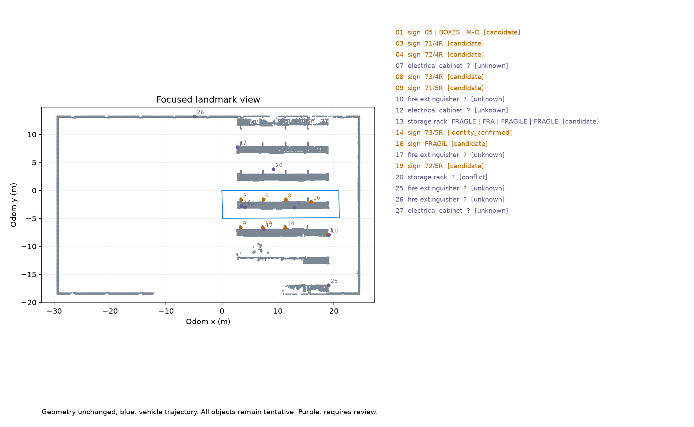

# Warehouse VLN

## 仓库两任务演示

### 1. 环绕仓库并建立语义地图



*完整任务的 8 倍速动画预览，3 fps；原视频 174.8 秒。* [完整建图视频（MP4）](demo/semantic_mapping/warehouse-navigation/mapping.mp4)

### 2. 利用地图前往当前视野外的 04/5R 标牌

初始指令：`Go to sign 04/5R and STOP beside it.` 地图与 Local 用于推导剩余 Route，初始指令不提供路径。



*完整任务的 4 倍速动画预览，3 fps；原视频 72.8 秒。* [完整目标导航视频（MP4）](demo/semantic_mapping/warehouse-navigation/target.mp4)

两段动画直接在 README 中播放；完整视频保留正常速度与清晰文字。画面展示 Codex 会话标注的 Landmark、Local、递归 Route、RGB Waypoint 及语义地图。这一版使用既有车辆运动回放，新标注未驱动车辆，不能视为新预测完成了自主导航闭环。

## 实施计划与安排

[**当前落地计划（2026-11-20 更新）**](docs/implementation_plan_20261118.md)：确定前视 VLM／Reference＋多方向 AE、两个 RGB Waypoint＋连续参考线；安排 InternVL3-1B＋LoRA＋完整 Decoder 训练、秩／容量及后续全量 SFT 对照，补充首轮数据配比、重建场景任务与轨迹 Oracle、DriveVLM 部署优化。以上是下一版本设计，运行代码与历史五点数据尚未迁移；300个R2R任务的返回与待审核状态见文档中有日期的库存快照。

## 系统设计 v0.7

[**设计文档 PDF**](dynamic-warehouse-vln-design-v0.7.pdf) · [可编辑源稿](dynamic-warehouse-vln-design-v0.7.md) · [构建与核验说明](docs/design/README.md)

2026-11-23 将 v0.7 精简为 **Model Pipeline、Training Schedule、Data Engine、Deployment Optimization** 四部分的算法方案，目录包含全部编号标题。模型总图参考 ABot-N0、TIC-VLA、AwareVLN 的论文表达重绘，结合仓库示教 RGB、检测与语义地图；VLM 输入输出和两点锚点归入 1.2，1.7.3 补充 Scorer，数据引擎明确静态／动态轨迹 Oracle，目录支持整行点击跳转；移除代码索引及存储、事件等开发细节。纳入前视 VLM／多方向 AE、LoRA／容量／全量 SFT 对照、数据配比及轨迹 Oracle；v0.6 原件和历史 v0.7 源稿保留。

## 语义建图演示

**连续导航Demo v2：** 两个任务都从完整Route（含最终STOP）开始，后续递归更新剩余步骤；先环绕，再前往第二通道的`04/5R`。三次曲线接管时实测均保持约0.30m/s。[原速视频与七次输出](demo/warehouse_navigation/run-20261112-v2/index.html) · [实跑报告](demo/warehouse_navigation/run-20261112-v2/REPORT.md) · [启动命令](demo/warehouse_navigation/README.md)。视频聚焦Semantic map、Landmark、Local、Route、Waypoint；依旧是Codex代答，OCR冲突没有隐藏。

**2026-11-12：环绕建图＋视野外编号导航 Demo。** 使用人工标注的 `manual-static-004` 原仓库；Codex代答五个waypoint，PCHIP拟合＋Pure Pursuit控制真实Isaac车辆。已完成52.56m环绕，再根据本轮地图导航到开始时看不到的`03/4R`旁停车。[启动说明](demo/warehouse_navigation/README.md) · [视频/全部决策HTML](demo/warehouse_navigation/run-20261112-d/index.html) · [结果与OCR冲突限制](demo/warehouse_navigation/run-20261112-d/REPORT.md)。这是Codex代答工程演示，不是已训练VLA的能力验收；本地页面启动方法见说明。

[**打开完整演示：视频、语义地图与实验报告 →**](https://running5rat.github.io/VLN_Warehouse/)

首次使用需按下文启用 GitHub Pages；部署成功后上方入口生效。

[](https://running5rat.github.io/VLN_Warehouse/)

*12 秒演示片段，3 fps GIF。完整页面包含 95 秒实时建图组合视频和 89.6 秒车载相机视频；预览帧率不代表模型完成频率。*



基于 `7b97f85622de91674327166f6f84d5390059a306` 的建图能力，在 Isaac Sim 5.0 的 `original` 仓库场景实际绕环一周：51.59 米、448 帧 RGB-D 全部进入几何地图；27 个原始地标，后处理显示 17 个，其中包含六个完整编号。物体静态状态仍为 `tentative`，实时延迟门槛未全部达到。

- [本次结果与限制](demo/semantic_mapping/original-20261013/REPORT.md)
- [演示目录、地图加载及复现说明](demo/semantic_mapping/README.md)
- [车载相机视频文件](demo/semantic_mapping/original-20261013/isaac_camera.mp4)
- [实时建图视频文件](demo/semantic_mapping/original-20261013/mapping_live.mp4)
- [HTML 源文件](demo/semantic_mapping/original-20261013/index.html)（仓库文件页显示源码；观看完整界面请使用上方 Pages 入口）

### 启用在线演示

1. 将本次 README、`demo/`、`.gitignore` 和 `.github/workflows/semantic-demo-pages.yml` 推送到 `main`。
2. 在仓库 **Settings → Pages → Build and deployment → Source** 选择 **GitHub Actions**。
3. 在 **Actions → Publish semantic mapping demo → Run workflow** 运行发布。之后 `main` 上演示文件更新会自动发布。
4. 部署成功后，通过 `https://running5rat.github.io/VLN_Warehouse/` 观看完整页面。

README 中的 GIF 和地图随代码推送即可显示；完整 HTML 页面通过 Pages 提供视频播放器。配置文件已准备好，仓库设置和远端发布尚需执行。发布构建仅复制页面实际引用的静态素材，不启动仿真或模型。

完整地图归档 `map.tar.gz` 约 833 MiB，保留在本地并已加入忽略规则，不能作为普通 Git 文件推送。需要公开下载时，可单独上传到 GitHub Release，再添加下载链接；不影响视频与地图预览。参见 [GitHub Pages 配置说明](https://docs.github.com/en/pages/getting-started-with-github-pages/using-custom-workflows-with-github-pages) 和 [GitHub 大文件限制](https://docs.github.com/en/repositories/working-with-files/managing-large-files/about-large-files-on-github)。

## 自然语言导航：第一阶段

已加入 `--instruction`、递归结构化 Route、执行事实及原 Decoder 一致性诊断。自然语言入口默认 `reference-only`，车辆不执行模型命令；旧建图入口保持可用。**接口验证通过不代表任务完成：本轮真实基础模型存在动作误解和空 waypoint，导航能力尚未验收通过。**

- [启动命令、协议与实现说明](docs/warehouse_navigation_phase1.md)
- [真实 VLM 与 Isaac 第一阶段报告](docs/warehouse_navigation_phase1_results.md)

## 人工与辅助标注（第二阶段）

**2026-11-13：R2R 标注扩至累计300任务。** 已冻结新增176任务、2,012关键帧，接续既有120训练池任务和4试点任务；使用原Qwen 3.7 Plus Route递归保留配置，先准备分割/OCR再调用教师。进度页 `http://localhost:8805/progress.html`，规则统计 `http://localhost:8805/statistics.html`。启动不代表已完成，详见[本轮执行说明](docs/r2r_extend300.md)。全量10,819任务的付费标注仍未授权启动。

**2026-11-12：完整 R2R 训练集数据准备。** 用户本轮选择先准备数据、暂不调用 API。已核验原始训练集 10,819 个任务、61 个建筑和完整轨迹；按 3,603 条精确等价回放复用 RGB-D，任务指令、源身份与后续递归上下文仍独立。全量处理状态见本机 `http://localhost:8798/`，命令、文件结构与验收边界见[全量 R2R 准备说明](docs/r2r_full_preparation.md)。该入口不会读取 API 凭据或生成语义标签；启动处理不代表全量已完成。

2026-11-05：修复代理连接后，已在新目录恢复[剩余108个R2R任务、1,154帧的v6标注](docs/r2r_v6_remaining108.md)，使用用户提供的当前prompt；进度页为 `http://localhost:8793/progress.html`。原11月4日的超时记录及预算预留保留。运行进度与最终验收分开记录；旧12任务不重复调用。此前[v5提示与费用估算](docs/qwen_plus_prompt_cost_20261104.md)保留作历史记录。

**R2R v4 扩展标注（2026-10-30）：**[12个新任务的运行与审核说明](docs/r2r_v4_batch12.md)。用户确认12个任务，覆盖12栋建筑、144个关键帧；不自动扩至120个，结果与人工批准分开记录。

**R2R 标注试点：**[实施、运行与审核说明](docs/r2r_semantic_pilot.md)。固定四个完整任务、40个关键帧，独立室内26类词表、Qwen Plus、RGB-D＋理想局部 odom；交付逐任务视频与全部输入输出，标签待人工审核，不自动扩批或训练。

**2026-10-29 当前教师配置：**下一阶段暂定 **Qwen `qwen3.7-plus`**，开启思考（2048 tokens）、输出上限 8192 tokens。模型、模板、输入与失败规则已固定在 [Plus 标注配置说明](docs/qwen_plus_annotation_profile.md) 和 [配置文件](configs/dataset_preparation/qwen_plus_teacher.v1.json)。单帧超长不再中断整段任务；失败帧不入图，后续用最近有效上下文继续。仍需人工审核，本次未重新进行付费评测。

**当前规范（2026-10-28）：**[VLM 标注方案与输入输出规范](docs/vlm_annotation_and_io_spec.md) 统一说明人工/教师标注、语义地图递归、Landmark/Local/Route 与 waypoint/ref_line 的来源和格式。教师可使用详细标注规则；学生训练与车端应共用短模板。证据输入已精简为 `plain-evidence-v2`，**SYSTEM 拆分仍待实施**，本次文档更新不代表已切换模型提示或重新评测。

**当前能力：静态数据采集、人工标注、轨迹提取、会话辅助文本标注和回放已可用；无人值守 API 自动标注尚未验收。** `manual-static-004` 的10个关键帧已由用户批准并统一为英文。最新连续回放为人工任务37次、无行人叉车任务17次更新，54份会话辅助文本通过格式/来源检查，仍待人工审核。无行人叉车版本是静态相机路径重渲染，不是重新驾驶得到的静态专家轨迹。

以下命令均从仓库根目录执行。采集脚本自动桥接宿主 `/data/isaacsim` 的 Isaac Sim 5.0；离线工具使用 `/data/ticvla/envs/warehouse-io/bin/python`，不在 Isaac Python 中运行。`/data/ticvla` 是本机数据路径，换机器需替换；新实验使用新输出目录。

### 1. 人工驾驶与离线标注

```bash
bash DynaNav/warehouse_loop/run_annotation.sh \
  --mode capture \
  --instruction "Go straight along the aisle, turn left at its end, then continue straight toward the fire extinguisher you see." \
  --output "/data/ticvla/datasets/manual-static-$(date +%Y%m%d-%H%M%S)"
```

打开 `http://localhost:8767/`：开始录制 → 点击驾驶区域，W/A/D或方向键驾驶，松键/空格停车 → 标记实际发生的转向、目标可见、停车和到达事件 → 结束采集 → 按关键帧顺序填写 Landmark、Local、Route，审核参考线 → 批准并导出。默认只监听本机；远程可用 `ssh -L 8767:127.0.0.1:8767 用户@服务器` 后打开本机地址。

- 一次 episode 是一个完整场景任务，不必标注每张RGB；默认约10个关键帧，事件帧会追加。
- 新 Landmark 使用类别数组（如 `["sign"]`），程序绑定当前源帧；旧 `image_id/category` 数组保留兼容。Local、Route 和 instruction 使用英文，新 Route 为剩余指令字符串或 `DONE`，不再要求 current_subgoal/status。界面有格式示例，旧批准记录不重写。
- 不编辑参考线时，候选来自后续实际示范轨迹；五个 waypoint 从同一条参考线按弧长抽取，仍需审核后才能成为GT。未来轨迹只用于标签，不进入VLM输入。
- 首个静态样本不标注ActionExpert；缺失动作标签不等于停车标签。完成状态需要真实的目标可见、停车和到达确认事件。

重开已完成的人工工程、导出并校验：

```bash
bash DynaNav/warehouse_loop/run_annotation.sh \
  --mode replay --output /data/ticvla/datasets/manual-static-004

/data/ticvla/envs/warehouse-io/bin/python -m ticvla.warehouse.dataset_pipeline export \
  --project /data/ticvla/datasets/manual-static-004/annotation \
  --output /data/ticvla/outputs/manual-static-004-export-new

/data/ticvla/envs/warehouse-io/bin/python -m ticvla.warehouse.dataset_pipeline validate \
  --record /data/ticvla/outputs/manual-static-004-export-new/00000000.json
```

### 2. 会话辅助标注：当前已验证的文本提议方式

它准备源帧输入，由人工或当前会话查看图像后回答，再导入校验；**命令本身不调用VLM/API**。下一轮使用上一份合法Route及带相对运动的Local。这里只补 `landmark/local/route`，waypoint和参考线保留独立几何来源。

```bash
# 为完整人工任务补选时刻：最长5秒，并按参考线余量和转向提前刷新。
/data/ticvla/envs/warehouse-io/bin/python -m ticvla.warehouse.dataset_tools.reference_schedule \
  --episode /data/ticvla/datasets/manual-static-004/capture/raw/episode.json \
  --seed-session /data/ticvla/outputs/dataset-preparation/session-teacher-20261015 \
  --seed-group manual \
  --output /data/ticvla/outputs/manual-dense-review-new

# 上一步已生成 bundle、coverage.json 和 session/00000000/input.json。
# 查看该 input.json 及引用图像，填写 /path/to/answer.json 后导入。
/data/ticvla/envs/warehouse-io/bin/python -m ticvla.warehouse.dataset_pipeline semantic-session \
  --output /data/ticvla/outputs/manual-dense-review-new/session \
  --response /path/to/answer.json

# 准备下一时刻，重复“查看、回答、导入”，直到整段完成。
/data/ticvla/envs/warehouse-io/bin/python -m ticvla.warehouse.dataset_pipeline semantic-session \
  --output /data/ticvla/outputs/manual-dense-review-new/session
```

回答信封格式如下。两个绑定值须复制当前 `input.json`，属于导入时的外部校验信息，不是要求 VLM decode 的字段。示例不是固定答案。

```json
{
  "input_sha256": "<复制当前输入的值>",
  "source_binding": "<复制当前输入的值>",
  "answer": {
    "landmark": [],
    "local": "unknown",
    "route": "Continue to the aisle end, then turn left and approach the fire extinguisher."
  }
}
```

当前模型输入包含原始/历史 RGB、同帧检测叠图与类别、因果语义 MapView、原任务、上一 Route/Local 与相对运动。不发送 Progress/执行事件、到达条件、速度或文字地标表；这些仍可留在外部审计和校验侧。未来图像、未来轨迹和当前人工标准答案不进入模型。`proposal.json` 是未批准提议，格式通过不代表语义正确。密集回放的源时间切换不包含真实模型耗时，也不代表在线推理频率；旧数据缺少语义层时明确标缺失。

### 3. API 自动标注：已有入口，真实调用待验收

当前 `semantic-teacher` 只接受 `semantic-teacher-pilot-v1` 的**最多6帧试验包**；不能直接输入上述37/17帧的 `semantic-episode-review-v1` 包。整段自动调用、恢复与审核导出仍是待补的少量工程工作，不能靠拆成独立6帧包重置Route。

配置文件结构如下，实际使用时填写账户可用的模型ID，并在运行进程环境中安全配置 `api_key_env` 指定的变量；不要把密钥写入配置或Git。当前会话辅助额度不是这个脚本的API凭据。

```json
{
  "model": "<实际可用的模型ID>",
  "base_url": "https://api.openai.com/v1",
  "api_key_env": "OPENAI_API_KEY",
  "max_output_tokens": 2048,
  "timeout_seconds": 180
}
```

```bash
# 先从已批准人工基准构造6帧小包，不调用API。
/data/ticvla/envs/warehouse-io/bin/python -m ticvla.warehouse.dataset_pipeline semantic-prepare \
  --project /data/ticvla/datasets/manual-static-004/annotation \
  --indices 0 3 4 6 8 9 --context-mode recursive \
  --output /data/ticvla/outputs/teacher-manual-bundle-new

# 仅检查请求准备；配置文件中model可先为null，--prepare-only保证不调用API。
/data/ticvla/envs/warehouse-io/bin/python -m ticvla.warehouse.dataset_pipeline semantic-teacher \
  --bundle /data/ticvla/outputs/teacher-manual-bundle-new \
  --config /path/to/teacher-config.json --prepare-only \
  --output /data/ticvla/outputs/teacher-manual-preview-new

# 配置实际模型与凭据后，使用另一新目录执行真实小规模请求。
/data/ticvla/envs/warehouse-io/bin/python -m ticvla.warehouse.dataset_pipeline semantic-teacher \
  --bundle /data/ticvla/outputs/teacher-manual-bundle-new \
  --config /path/to/teacher-config.json \
  --output /data/ticvla/outputs/teacher-manual-run-new
```

保存 `input.json`、API原始 `response.json`、`raw.txt`、`proposal.json`、`geometric-supervision.json` 和报告。每个时刻一次请求，失败不自动修复，失败后的递归请求不继续执行。模型/凭据缺失时报告阻塞，调用数为0；没有真实调用成功和人工审核，不能标记自动标注验收通过。

### 4. 查看最新视频与后续优先级

```bash
/data/ticvla/envs/warehouse-io/bin/python -m ticvla.warehouse.dataset_tools.video_server \
  --port 8774 \
  --directory /data/ticvla/outputs/dataset-preparation/static-refresh-20261015/videos
```

浏览器打开 `http://服务器IP:8774/`。一个场景任务一段视频，到达源帧时同时更新五项结果。当前实验文件只保存在本机，不随本次文档提交上传到GitHub Pages。

**下一步先做数据组成与格式对齐；暂缓动态环境Oracle、动态轨迹标注、Flow/Scorer训练。** 这不代表自动标注全部完成：真实API小样本验收及提议审核/导出可作为独立小任务补齐，不阻塞数据盘点。不开展正式训练或批量教师调用。

- [数据组成、来源优先级、格式与验收计划](docs/warehouse_dataset_alignment_plan.md)
- [人工标注详细说明](docs/warehouse_dataset_preparation.md)
- [教师链路、静态替换与回放来源](docs/warehouse_semantic_teacher.md)

## 建图运行

当前建图入口为 [run_realtime.sh](DynaNav/warehouse_loop/run_realtime.sh)，在项目根目录执行：

```bash
bash DynaNav/warehouse_loop/run_realtime.sh \
  --selection-mode instances \
  --landmark-variant original \
  --port 8765 \
  --output "/data/ticvla/outputs/warehouse-loop/instances-original-$(date +%Y%m%d-%H%M%S)" \
  --keep-viewer
```

它会自动启动 Isaac Sim，控制车辆绕环，同时运行：

- RGB-D 采集、几何建图和 YOLO-E 候选分割：目标 5 Hz。
- InternVL：每 2 秒筛选一次源帧候选实例，不输入导航任务。
- OCR：目标 1 Hz，文字绑定到对应实例。
- 地图后处理：过滤普通重复结构，按当前子字符串规则处理 OCR 冲突。

无需手动切换 Python 环境，也无需提前打开 Isaac Sim；脚本使用 `/data/ticvla/envs/warehouse-realtime/bin/python` 运行感知链路。

启动后，在运行机器的浏览器打开 `http://localhost:8765` 查看检测、文字和地图。`--keep-viewer` 会在绕环结束后保留查看服务，按 Ctrl+C 退出。

综合变化场景将 `--landmark-variant original` 改成 `--landmark-variant combined`。上述频率为调度目标，实际完成频率以输出报告为准。

重新录制并生成演示材料：

```bash
bash demo/semantic_mapping/run_demo.sh
```
### 绕环后超视距地标的 Local / Route 审核

新增[地图记忆问答实验](docs/warehouse_map_memory_review.md)：先沿原轨迹完成一圈，仅运行地标筛选、分割和 OCR 建图；再基于停车源帧与已观测地图，询问当前 RGB 不可见的路标目标。Qwen、GLM 和 Codex 会话结果分别保存，导航车辆不再运动，不生成 waypoint、参考线或 AE 输出。

2026-10-26 的[本机审核页](/data/ticvla/outputs/map-memory-review-20261026/query/index.html)使用新采集的448帧，目标为73/5R。该实验提供理想 odom 位姿，验证地图关系推理，不证明 VLM 独立重定位或导航成功。API 截断、配置变化和会话辅助结果均单独列示，语义正确性等待人工审核。

## TODO - 后续实现计划
### 0．需要实现的能力和当前起点
当前 [验证记录](/project/docker/VLN/TIC-VLA/docs/warehouse_navigation_validation.md) 中，三种几何对照只验证了短距离运动与观测回流；模型模式尚未产生通过检查的有效前进命令。因此，不能把已有接口当成任务能力已经完成。
能力	需要达到的具体行为	当前主要缺口
地标目标导航	找到指定编号或物体，驶入其可通行邻域并停车	完整到达验证、歧义目标处理、目标重确认
路线指令导航	按顺序执行“直行、第二个路口左转、到尽头”	子句进度、路口计数、转向事件核验
相对运动	按锁定起点倒退指定距离	负速度控制、后向观测、距离累计
前沿探索	持续选择可达前沿、扩展地图，按预算或边界结束	持续探索、重复目标抑制、失败恢复
行人跟随	保持同一目标，转弯、等待，丢失后停车	持续跟随质量、遮挡恢复、身份保持
动态环境导航	临时障碍让行、绕行，持续封路时重新规划	动态占用、候选训练、重规划触发
跨任务地图复用	换起点后确认自己在旧地图中的位置，再导航	自主重定位、配准歧义验证
多机器人共享	交换地图增量，正确配准、去重和撤销错误融合	当前尚未实现


精确停靠、物理取货仍不属于 v0.6 当前范围。
### 1．第一阶段：补齐任务执行底座和当前协议缺口
这一阶段先不训练，目的是让后续模型输出有明确的执行含义和验证标准。
主要修改：
- 扩展 NavigationState：支持任意路线指令和相对运动，不再只有当前三种固定任务模板。
- 固定保存原任务、目标身份、子任务起点和完成条件。
- 将已经过的路口、已完成转向、累计距离等作为执行事实保存，Route 刷新不能重置这些事实。
- 补充地标歧义、不可达、目标未观测、任务取消与预算耗尽等状态。
- 本轮倒退只做静止参考线诊断：传递后向方向标记并保存原 Decoder 输出，不执行物理倒车、不增加后向传感器。物理倒车控制留待后续阶段。
- 将长期地图和当前动态占用分开维护，旧地图中的自由空间不能覆盖新障碍。
同时修复前面发现的 VLM 协议问题：
- prompt 明确 Route 是剩余指令与当前子目标。
- 明确五个 waypoint 是同一局部路线上的有序空间锚点，单位、坐标系、有效范围和空输出条件完整说明。
- 增加 TEXT 锚点与连续参考线的运行时一致性检查。
- TEXT 返回空 waypoint 时，不能继续把未经解释和验证的非空 Decoder 输出当成有效 TEXT 路线。
- PREFILL_FOLLOW 没有文本 waypoint，应单独判断参考线有效性。
- 非跟随 TEXT 的地标事件需要得到真实“分割—投影—入图”正例；目前导航测试中的空地标输出尚未验证这条支路的有效性。
**阶段验收：**用几何对照完成明确终点的任务、顺序指令和停止条件；确认任务事实不被 Route 覆盖。模型模式与几何对照继续分别记录。
### 2．第二阶段：静态数据组成与格式对齐优先

**2026-10-15 调整：**当前执行范围以[数据对齐计划](docs/warehouse_dataset_alignment_plan.md)为准；先完成原七步中的第5、6步。下列动态任务、动作Oracle与执行验收保留为后续路线，暂不执行。
现有固定绕环数据适合验证建图，不足以直接训练各种导航能力：它没有充分覆盖任务选择、转向计数、倒车、让行和恢复行为。
建议新增以下场景，每种都包含成功、不可解和恢复情况：
场景组	重点样本
地标导航	正确编号、重复编号、残缺读数、目标未观测、目标旁有障碍
路线指令	多子句、第一/第二路口、经过相似货架、部分子任务已完成
相对运动	不同起点、前进后倒车、中途暂停、后方出现障碍
探索	多个前沿、死路、不可达前沿、回访、发现新目标
跟随	直行、转弯、目标停下、遮挡、重新出现
动态干扰	行人横穿、推车阻挡、临时封路、封路解除


每个样本保存：
当时可用的 RGB 历史、MapView、odom
TaskContract、执行事实、旧 Route
合法的新结构化文本
局部参考线、五个同路线锚点、有效长度
当前条件下可行的模态与带时间轨迹
来源、版本、失败原因和监督有效性 mask
这里要区分两类 Oracle：
- 路线 Oracle：仅根据当时已观测地图、任务约束和目标观测生成局部路线。
- 动作 Oracle：生成动力学可行的时间轨迹，验证碰撞、速度、转向和制动；未来动态真值若用于监督，必须与部署输入隔离。
训练、验证、测试应按布局和 episode分组，不能将同一圈相邻帧随机拆到两边。之前反复分析过的 144 帧继续作为回归集。
**阶段验收：**人工抽检监督；用控制器实际执行 Oracle 轨迹，证明标签可执行。没有可靠标签的模态保留 unknown，不补造答案。
### 3．第三阶段：让 VLM 和参考线真正学会任务
对应文档 Stage 1a/1b。
建议先保持当前 MapView 渲染接口完成小规模训练，减少同时变化的模块；随后再实现文档规定的学习型 MapEncoder，并与渲染接口对照。
训练分两步：
- 可选短预热：冻结 VLM，训练新参考线接口，检查监督是否可学习。
- 联合适配：训练 VLM LoRA/选定层及参考线 Decoder；混合 TEXT 和 PREFILL_FOLLOW 样本。
监督包括：
- Landmark、Local、Route、waypoint 的文本监督；
- 参考线位置、端点、曲率、有效长度与置信度；
- 五个文本锚点与参考线对应同一路线；
- 路线不变时，对齐后的跨帧参考线一致性。
需要特别注意：
- 文本 token 的交叉熵不会自动把随机初始化的上下文压缩器训练好。
- 必须明确压缩器的训练路径。建议在动作训练阶段，用 Flow 损失联合训练压缩器和上下文投影，冻结 VLM、地图编码及参考线头；缓存压缩前 K/V，并对压缩器与快照版本一起管理。
- 不能只在输入标准答案 waypoint 的 teacher-forcing 条件下验证 Decoder。必须同时验证实际生成文本和无文本 PREFILL。
学习型 MapEncoder 后续补齐：
- 栅格分支：自由、占用、未知、禁行和地标通道；
- 图分支：实体、相对位置、连通性和朝向可观测性；
- 历史 Feature Bank：按文档的 256/128/64/32 token 预算压缩历史视觉信息。
**阶段验收：**在独立验证 episode 中，真实生成可执行的局部路线，保持原目标和子句顺序；地图改变后输出能做出相应变化。单纯复述任务或强制输出五个坐标不算通过。
### 4．第四阶段：训练九模态 Flow，让模型产生可执行运动（暂缓）
对应文档 Stage 2。
保留当前共享九模态结构，新增匹配部署接口的训练入口和数据加载器：
当前 RGB / BEV / 机器人状态
＋对齐参考线
＋真实语义上下文
＋来源年龄与相对位姿
＋上一轨迹剩余段
＋运动方向
→ 九模态带时间轨迹
重点工作：
- 实现条件 Flow Matching 训练，明确坐标归一化、物理时间和有效点 mask。
- 只对 Oracle 已验证的模态监督，不把其余模态自动标为错误。
- 在存在多种可行行为的场景中保留多条示范，例如左绕、右绕和等待。
- 加入实际测得的排队、推理和持有延迟，使用对齐后的旧参考线训练。
- 逐步从理想参考线切换到实际 VLM 生成、扰动和失效参考线。
- 初期继续使用规则 Scorer，先隔离“候选不会生成”和“候选选错”两类问题。
其中，AE 的纵向 FOLLOW 表示沿参考线跟进及调速，不等于任务层的行人跟随。
**阶段验收：**模型候选通过原有检查，产生实际非零控制，并完成短任务；不能用几何对照替换模型候选后算作通过，也不能仅靠裁剪异常轨迹使其看似可执行。
### 5．第五阶段：学习型 Scorer、动态闭环与恢复
对应文档 Stage 3/4。
当 Flow 已能产生有效候选后，再训练 Scorer：
- 候选级输出：安全性、任务进展、参考线偏差、舒适性及排序。
- 模态级输出：可行性，并区分正例、负例与未知。
- 先用宽分布 Oracle 候选，再用当前冻结 Flow 的实际候选校准。
- 可行性头校准前保持 λ_f=0；学习评分不能恢复被硬检查拒绝的候选。
随后进行闭环数据聚合：
运行模型 → 收集失败状态 → Oracle 重标注
→ 更新 Flow → 冻结 Flow
→ 重新生成候选并校准 Scorer
重点收集偏航、长期停车、过期路线、封路、让行犹豫和跟随丢失。若根因是 Route 或地标错误，单独修复语义分支，不让动作训练承担全部问题。
**阶段验收：**三种现有任务加路线指令、倒车，分别完成端到端 episode；对动态障碍和目标丢失验证停车、等待与恢复。每次报告真实控制来源、任务完成情况、碰撞/接管、有效候选率和来源年龄。
### 6．最后推进地图复用和目标硬件部署
这部分可与前述训练部分并行准备，但不能以当前标牌文字读出作为“已具备定位能力”的依据。
- 先做单机器人新起点重定位：文字、类别和几何产生候选，独立几何验证决定是否接受变换。
- 重复编号、几何多解和无重叠时保持子图分离。
- tentative 对象可用于候选检索，但不能直接升级成永久配准锚点。
- 再做多机器人地图增量同步、证据去重、位姿图优化和错误融合撤销。
- 最后在实际工作站—网络—Orin 链路上测量端到端性能。当前 RTX 4090 的前向耗时不能替代文档目标硬件上的验收结果。

## Stage1a 训练链路验收

按“人工数据真实训练 → R2R/RxR 待标注数据 → 教师比较与人工审核 → 首批训练”顺序推进。当前只继续比较 Qwen，GPT 计划 pending，五模型方案作为历史计划保留。近期先冻结教师/学生分离的模板并完成新模板诊断，再扩展审核标签；详见[当前规范与实施顺序](docs/vlm_annotation_and_io_spec.md#6-近期实施顺序与验收)。命令、数据权限与历史验收输出见 [Stage1a 实施说明](docs/stage1a_training_acceptance.md)。人工 demo 的拟合结果不作为独立导航评测。

2026-10-22 已接入外部凭据文件，GLM 国内站与 Qwen 北京区已产生真实图像标注；完整请求、回答、格式失败及用量见本机 `/data/ticvla/outputs/stage1a/oracle-live-20261022-v2/index.html`。OpenAI 请求返回 `credit_balance_exhausted`，暂停等待 API 余额恢复。共同历史上下文和教师提议仍需人工审核，C 阶段尚未完整通过，D 阶段未启动。凭据不写入仓库；调用方式见上述实施说明。

2026-10-26 简化协议的 [Oracle 人工审核页](/data/ticvla/outputs/stage1a/oracle-review-20261026/index.html) 与 [费用报告](/data/ticvla/outputs/stage1a/oracle-review-20261026/REPORT.md) 已保存到本机。逐帧对照 GLM/Qwen 的 Landmark 类别、Local 与自然语言 Route，保留失败、实际 token 用量及人工审核导出；OpenAI 仍无余额，本轮不重试。报告按首批实际 3,458 个关键帧估算 Stage1a 费用，尚未批准为训练标签。打开方法与审核步骤见 [语义教师说明](docs/warehouse_semantic_teacher.md#简化协议的多模型人工审核与费用报告2026-10-26)；这些本机 `/data` 链接不是 GitHub 托管页面。

2026-10-27：**GPT 标注计划按用户要求 pending，当前只比较 Qwen。** 已完成 Max/Plus/Omni 与思考开关的真实小样本对照，新增157次请求，完整对照、打开方式和复现命令见 [Qwen 教师分级实测](docs/qwen_teacher_comparison.md)。准确性优先仍保留Max思考；Plus有限思考为低成本待审核候选，尚未证明等效替代。保留全部失败与原文，未自动批准标签或开展批量训练。

### 建图与导航联合标注：语义地图闭环

后续 VLM 评测与标注质量审核统一遵循 [Agent.md：人工审核标准输出](Agent.md)。以一个完整场景任务为单位展示全部预定关键帧的实际输入、原始输出、地图反馈和逐字段评价；教师标注不要求生成 waypoint，系统评测展示真实 waypoint 与 Decoder 参考线。

新的 [语义地图闭环说明](docs/semantic_mapping_navigation_loop.md) 提供复现命令和输入定义：当前原始 RGB＋同帧检测候选＋上一轮语义地图，经一次 VLM 输出 Landmark/Local/Route，再用同帧 mask、深度与 OCR 更新独立地图，作为下一轮输入。教师与本地训练/导航共享视觉字段构建器，保留旧数据兼容。

2026-10-27 人工 demo 复验：Qwen Plus 完成 10 轮地图反馈；Max 第 3 轮因 Local 超长停止。结果保存在 `/data/ticvla/outputs/stage1a/semantic-loop-20261027/index.html`。标签仍待人工审核，详情与错误归因见上述文档；未重新验收 Isaac 在线性能。

用户指定更新：新标注默认使用Qwen Plus v6原文提示，详见[token来源拆分、单价与R2R预算](docs/qwen_plus_prompt_cost_v6_20261104.md)。历史v4/v5统计保留；v6估算未作为真实API测量。
