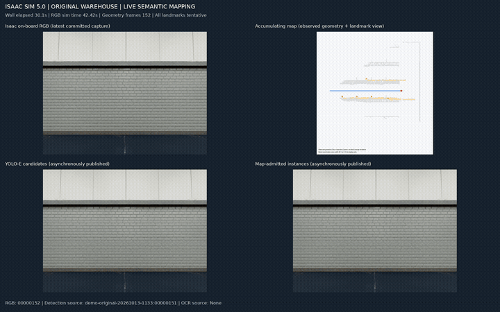
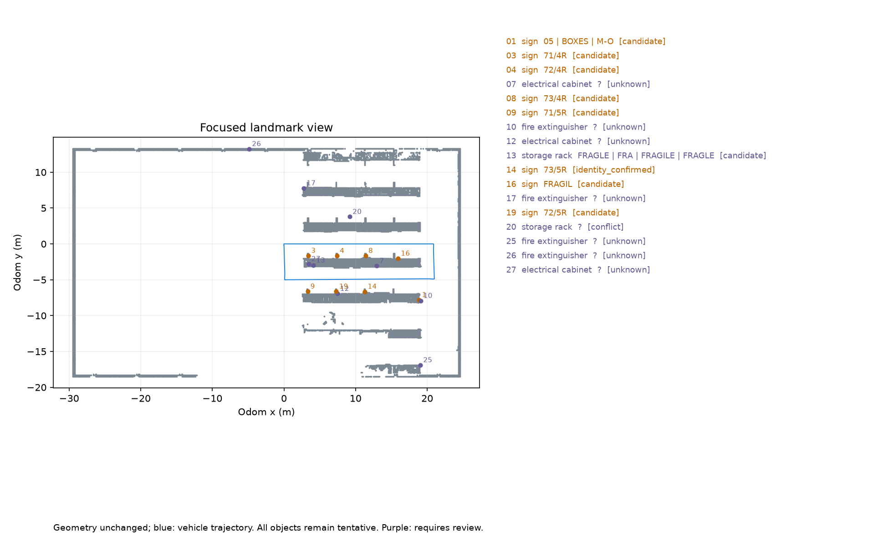

# Warehouse VLN

## 语义建图演示

[**打开完整演示：视频、语义地图与实验报告 →**](https://running5rat.github.io/VLN_Warehouse/)

首次使用需按下文启用 GitHub Pages；部署成功后上方入口生效。

[](https://running5rat.github.io/VLN_Warehouse/)

*12 秒演示片段，3 fps GIF。完整页面包含 95 秒实时建图组合视频和 89.6 秒车载相机视频；预览帧率不代表模型完成频率。*



基于 `7b97f85622de91674327166f6f84d5390059a306` 的建图能力，在 Isaac Sim 5.0 的 `original` 仓库场景实际绕环一周：51.59 米、448 帧 RGB-D 全部进入几何地图；27 个原始地标，后处理显示 17 个，其中包含六个完整编号。物体静态状态仍为 `tentative`，实时延迟门槛未全部达到。

- [本次结果与限制](demo/semantic_mapping/original-20261013/REPORT.md)
- [演示目录、地图加载及复现说明](demo/semantic_mapping/README.md)
- [车载相机视频文件](demo/semantic_mapping/original-20261013/isaac_camera.mp4)
- [实时建图视频文件](demo/semantic_mapping/original-20261013/mapping_live.mp4)
- [HTML 源文件](demo/semantic_mapping/original-20261013/index.html)（仓库文件页显示源码；观看完整界面请使用上方 Pages 入口）

### 启用在线演示

1. 将本次 README、`demo/`、`.gitignore` 和 `.github/workflows/semantic-demo-pages.yml` 推送到 `main`。
2. 在仓库 **Settings → Pages → Build and deployment → Source** 选择 **GitHub Actions**。
3. 在 **Actions → Publish semantic mapping demo → Run workflow** 运行发布。之后 `main` 上演示文件更新会自动发布。
4. 部署成功后，通过 `https://running5rat.github.io/VLN_Warehouse/` 观看完整页面。

README 中的 GIF 和地图随代码推送即可显示；完整 HTML 页面通过 Pages 提供视频播放器。配置文件已准备好，仓库设置和远端发布尚需执行。发布构建仅复制页面实际引用的静态素材，不启动仿真或模型。

完整地图归档 `map.tar.gz` 约 833 MiB，保留在本地并已加入忽略规则，不能作为普通 Git 文件推送。需要公开下载时，可单独上传到 GitHub Release，再添加下载链接；不影响视频与地图预览。参见 [GitHub Pages 配置说明](https://docs.github.com/en/pages/getting-started-with-github-pages/using-custom-workflows-with-github-pages) 和 [GitHub 大文件限制](https://docs.github.com/en/repositories/working-with-files/managing-large-files/about-large-files-on-github)。

## 建图运行

当前建图入口为 [run_realtime.sh](DynaNav/warehouse_loop/run_realtime.sh)，在项目根目录执行：

```bash
bash DynaNav/warehouse_loop/run_realtime.sh \
  --selection-mode instances \
  --landmark-variant original \
  --port 8765 \
  --output "/data/ticvla/outputs/warehouse-loop/instances-original-$(date +%Y%m%d-%H%M%S)" \
  --keep-viewer
```

它会自动启动 Isaac Sim，控制车辆绕环，同时运行：

- RGB-D 采集、几何建图和 YOLO-E 候选分割：目标 5 Hz。
- InternVL：每 2 秒筛选一次源帧候选实例，不输入导航任务。
- OCR：目标 1 Hz，文字绑定到对应实例。
- 地图后处理：过滤普通重复结构，按当前子字符串规则处理 OCR 冲突。

无需手动切换 Python 环境，也无需提前打开 Isaac Sim；脚本使用 `/data/ticvla/envs/warehouse-realtime/bin/python` 运行感知链路。

启动后，在运行机器的浏览器打开 `http://localhost:8765` 查看检测、文字和地图。`--keep-viewer` 会在绕环结束后保留查看服务，按 Ctrl+C 退出。

综合变化场景将 `--landmark-variant original` 改成 `--landmark-variant combined`。上述频率为调度目标，实际完成频率以输出报告为准。

重新录制并生成演示材料：

```bash
bash demo/semantic_mapping/run_demo.sh
```
## TODO - 后续实现计划
### 0．需要实现的能力和当前起点
当前 [验证记录](/project/docker/VLN/TIC-VLA/docs/warehouse_navigation_validation.md) 中，三种几何对照只验证了短距离运动与观测回流；模型模式尚未产生通过检查的有效前进命令。因此，不能把已有接口当成任务能力已经完成。
能力	需要达到的具体行为	当前主要缺口
地标目标导航	找到指定编号或物体，驶入其可通行邻域并停车	完整到达验证、歧义目标处理、目标重确认
路线指令导航	按顺序执行“直行、第二个路口左转、到尽头”	子句进度、路口计数、转向事件核验
相对运动	按锁定起点倒退指定距离	负速度控制、后向观测、距离累计
前沿探索	持续选择可达前沿、扩展地图，按预算或边界结束	持续探索、重复目标抑制、失败恢复
行人跟随	保持同一目标，转弯、等待，丢失后停车	持续跟随质量、遮挡恢复、身份保持
动态环境导航	临时障碍让行、绕行，持续封路时重新规划	动态占用、候选训练、重规划触发
跨任务地图复用	换起点后确认自己在旧地图中的位置，再导航	自主重定位、配准歧义验证
多机器人共享	交换地图增量，正确配准、去重和撤销错误融合	当前尚未实现


精确停靠、物理取货仍不属于 v0.6 当前范围。
### 1．第一阶段：补齐任务执行底座和当前协议缺口
这一阶段先不训练，目的是让后续模型输出有明确的执行含义和验证标准。
主要修改：
- 扩展 NavigationState：支持任意路线指令和相对运动，不再只有当前三种固定任务模板。
- 固定保存原任务、目标身份、子任务起点和完成条件。
- 将已经过的路口、已完成转向、累计距离等作为执行事实保存，Route 刷新不能重置这些事实。
- 补充地标歧义、不可达、目标未观测、任务取消与预算耗尽等状态。
- 完善倒车接口。当前运行条件中的 motion_direction 固定为正向，仅有这个字段还不代表已支持倒车；控制器、候选检查和后向传感覆盖必须一起补齐。
- 将长期地图和当前动态占用分开维护，旧地图中的自由空间不能覆盖新障碍。
同时修复前面发现的 VLM 协议问题：
- prompt 明确 Route 是剩余指令与当前子目标。
- 明确五个 waypoint 是同一局部路线上的有序空间锚点，单位、坐标系、有效范围和空输出条件完整说明。
- 增加 TEXT 锚点与连续参考线的运行时一致性检查。
- TEXT 返回空 waypoint 时，不能继续把未经解释和验证的非空 Decoder 输出当成有效 TEXT 路线。
- PREFILL_FOLLOW 没有文本 waypoint，应单独判断参考线有效性。
- 非跟随 TEXT 的地标事件需要得到真实“分割—投影—入图”正例；目前导航测试中的空地标输出尚未验证这条支路的有效性。
**阶段验收：**用几何对照完成明确终点的任务、顺序指令和停止条件；确认任务事实不被 Route 覆盖。模型模式与几何对照继续分别记录。
### 2．第二阶段：建立导航监督数据与 Oracle
现有固定绕环数据适合验证建图，不足以直接训练各种导航能力：它没有充分覆盖任务选择、转向计数、倒车、让行和恢复行为。
建议新增以下场景，每种都包含成功、不可解和恢复情况：
场景组	重点样本
地标导航	正确编号、重复编号、残缺读数、目标未观测、目标旁有障碍
路线指令	多子句、第一/第二路口、经过相似货架、部分子任务已完成
相对运动	不同起点、前进后倒车、中途暂停、后方出现障碍
探索	多个前沿、死路、不可达前沿、回访、发现新目标
跟随	直行、转弯、目标停下、遮挡、重新出现
动态干扰	行人横穿、推车阻挡、临时封路、封路解除


每个样本保存：
当时可用的 RGB 历史、MapView、odom
TaskContract、执行事实、旧 Route
合法的新结构化文本
局部参考线、五个同路线锚点、有效长度
当前条件下可行的模态与带时间轨迹
来源、版本、失败原因和监督有效性 mask
这里要区分两类 Oracle：
- 路线 Oracle：仅根据当时已观测地图、任务约束和目标观测生成局部路线。
- 动作 Oracle：生成动力学可行的时间轨迹，验证碰撞、速度、转向和制动；未来动态真值若用于监督，必须与部署输入隔离。
训练、验证、测试应按布局和 episode分组，不能将同一圈相邻帧随机拆到两边。之前反复分析过的 144 帧继续作为回归集。
**阶段验收：**人工抽检监督；用控制器实际执行 Oracle 轨迹，证明标签可执行。没有可靠标签的模态保留 unknown，不补造答案。
### 3．第三阶段：让 VLM 和参考线真正学会任务
对应文档 Stage 1a/1b。
建议先保持当前 MapView 渲染接口完成小规模训练，减少同时变化的模块；随后再实现文档规定的学习型 MapEncoder，并与渲染接口对照。
训练分两步：
- 可选短预热：冻结 VLM，训练新参考线接口，检查监督是否可学习。
- 联合适配：训练 VLM LoRA/选定层及参考线 Decoder；混合 TEXT 和 PREFILL_FOLLOW 样本。
监督包括：
- Landmark、Local、Route、waypoint 的文本监督；
- 参考线位置、端点、曲率、有效长度与置信度；
- 五个文本锚点与参考线对应同一路线；
- 路线不变时，对齐后的跨帧参考线一致性。
需要特别注意：
- 文本 token 的交叉熵不会自动把随机初始化的上下文压缩器训练好。
- 必须明确压缩器的训练路径。建议在动作训练阶段，用 Flow 损失联合训练压缩器和上下文投影，冻结 VLM、地图编码及参考线头；缓存压缩前 K/V，并对压缩器与快照版本一起管理。
- 不能只在输入标准答案 waypoint 的 teacher-forcing 条件下验证 Decoder。必须同时验证实际生成文本和无文本 PREFILL。
学习型 MapEncoder 后续补齐：
- 栅格分支：自由、占用、未知、禁行和地标通道；
- 图分支：实体、相对位置、连通性和朝向可观测性；
- 历史 Feature Bank：按文档的 256/128/64/32 token 预算压缩历史视觉信息。
**阶段验收：**在独立验证 episode 中，真实生成可执行的局部路线，保持原目标和子句顺序；地图改变后输出能做出相应变化。单纯复述任务或强制输出五个坐标不算通过。
### 4．第四阶段：训练九模态 Flow，让模型产生可执行运动
对应文档 Stage 2。
保留当前共享九模态结构，新增匹配部署接口的训练入口和数据加载器：
当前 RGB / BEV / 机器人状态
＋对齐参考线
＋真实语义上下文
＋来源年龄与相对位姿
＋上一轨迹剩余段
＋运动方向
→ 九模态带时间轨迹
重点工作：
- 实现条件 Flow Matching 训练，明确坐标归一化、物理时间和有效点 mask。
- 只对 Oracle 已验证的模态监督，不把其余模态自动标为错误。
- 在存在多种可行行为的场景中保留多条示范，例如左绕、右绕和等待。
- 加入实际测得的排队、推理和持有延迟，使用对齐后的旧参考线训练。
- 逐步从理想参考线切换到实际 VLM 生成、扰动和失效参考线。
- 初期继续使用规则 Scorer，先隔离“候选不会生成”和“候选选错”两类问题。
其中，AE 的纵向 FOLLOW 表示沿参考线跟进及调速，不等于任务层的行人跟随。
**阶段验收：**模型候选通过原有检查，产生实际非零控制，并完成短任务；不能用几何对照替换模型候选后算作通过，也不能仅靠裁剪异常轨迹使其看似可执行。
### 5．第五阶段：学习型 Scorer、动态闭环与恢复
对应文档 Stage 3/4。
当 Flow 已能产生有效候选后，再训练 Scorer：
- 候选级输出：安全性、任务进展、参考线偏差、舒适性及排序。
- 模态级输出：可行性，并区分正例、负例与未知。
- 先用宽分布 Oracle 候选，再用当前冻结 Flow 的实际候选校准。
- 可行性头校准前保持 λ_f=0；学习评分不能恢复被硬检查拒绝的候选。
随后进行闭环数据聚合：
运行模型 → 收集失败状态 → Oracle 重标注
→ 更新 Flow → 冻结 Flow
→ 重新生成候选并校准 Scorer
重点收集偏航、长期停车、过期路线、封路、让行犹豫和跟随丢失。若根因是 Route 或地标错误，单独修复语义分支，不让动作训练承担全部问题。
**阶段验收：**三种现有任务加路线指令、倒车，分别完成端到端 episode；对动态障碍和目标丢失验证停车、等待与恢复。每次报告真实控制来源、任务完成情况、碰撞/接管、有效候选率和来源年龄。
### 6．最后推进地图复用和目标硬件部署
这部分可与前述训练部分并行准备，但不能以当前标牌文字读出作为“已具备定位能力”的依据。
- 先做单机器人新起点重定位：文字、类别和几何产生候选，独立几何验证决定是否接受变换。
- 重复编号、几何多解和无重叠时保持子图分离。
- tentative 对象可用于候选检索，但不能直接升级成永久配准锚点。
- 再做多机器人地图增量同步、证据去重、位姿图优化和错误融合撤销。
- 最后在实际工作站—网络—Orin 链路上测量端到端性能。当前 RTX 4090 的前向耗时不能替代文档目标硬件上的验收结果。